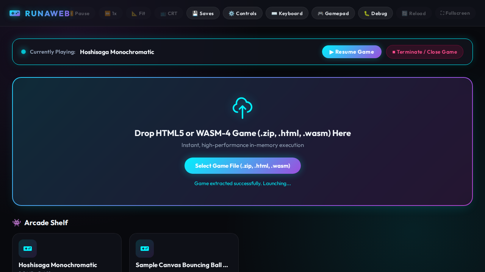
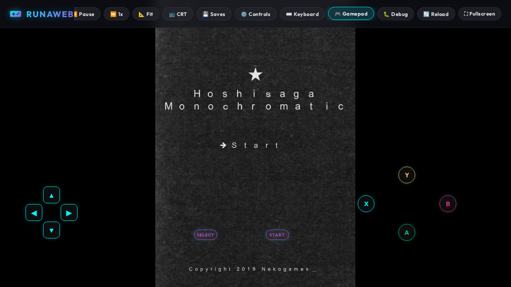

<div align="center">

# 🎮 RunaWeb

### Standalone, Zero-Backend HTML5 & WebGL Game Runner & Retro Arcade

[](https://www.gnu.org/licenses/gpl-3.0)
[](https://www.typescriptlang.org/)
[](https://vitejs.dev/)
[]()
[]()
[](https://m5devs.github.io/RunaWeb/)

**Play HTML5, WebGL, and WASM-4 games offline with zero servers, zero setup, and zero CORS headaches.**

[🚀 Play Live Demo](https://m5devs.github.io/RunaWeb/) · [Report Bug](https://github.com/M5Devs/RunaWeb/issues) · [Request Feature](https://github.com/M5Devs/RunaWeb/issues)

<br/>

<p align="center">
  
  
</p>

</div>

---

## ✨ Overview

Running exported HTML5, WebGL, or WebAssembly games locally often results in frustrating browser security errors (`CORS`, `file:///` restrictions, or missing web servers). 

**RunaWeb** solves this completely by embedding an in-browser virtual server and runtime. It intercepts asset requests via Service Workers and shared `CacheStorage`, allowing games to run seamlessly offline—directly in your browser, on desktop, or installed as a standalone PWA on mobile.

---

## 🌟 Key Features

- **🚀 Multi-Format Zero-Server Engine:** Drag & drop any game archive (`.zip`), standalone single file (`.html`), or retro cartridge (`.wasm`)—runs completely in-memory without external hosting or CORS errors.
- **👾 WASM-4 Fantasy Console Built-in:** Full 160×160 retro runtime with Web Audio APU synthesizer supporting all 4 channels (Pulse, Triangle, LFSR Noise) and note pitch mode.
- **📴 100% Offline & PWA:** Installable directly to your home screen (iOS / Android) or desktop. Works completely in Airplane mode.
- **🕹️ PPSSPP-Style Customizable Controls:** Translucent touch controls (D-Pad & Action buttons) with in-place live drag-and-drop repositioning, scale, opacity, and glyph-only borderless styling.
- **⌨️ Full PC Gaming Virtual Keyboard:** On-screen QWERTY keyboard featuring F1–F12 function keys, arrow cluster, and sticky modifier keys (Ctrl, Alt, Shift, Tab) for PC web games on mobile.
- **🎮 Physical Controller Support:** Native Gamepad API integration for Bluetooth and USB controllers (PlayStation, Xbox, 8BitDo) with automatic touch-controls hiding.
- **💾 Persistent Arcade Library & Quick Resume:** Saves uploaded games in `IndexedDB` (Afterplay-style) with auto-detected box art thumbnails, plus Quick Resume / suspend state.
- **📦 Save State Manager:** Export and import game `localStorage` save states safely with schema validation and host storage isolation.
- **📺 Retro Visuals & Theater Mode:** Full-viewport immersion with CRT scanline filter toggles and 4:3 / 16:9 / Fit aspect ratio controls.
- **⚡ Blazing Fast:** Powered by `fflate` for near-instant client-side zip decompression without main-thread blocking.

---

## 🛠️ Tech Stack

- **Core Engine:** TypeScript, Vite, Modern Web APIs (Service Worker, CacheStorage, Gamepad API, Web Audio API)
- **Archive Engine:** [fflate](https://github.com/101arrowz/fflate) (Ultra-fast in-memory zip handling)
- **Storage:** IndexedDB + CacheStorage (Afterplay-style architecture)
- **Testing Suite:** Vitest (Unit tests) + Playwright (Headless Chromium E2E automation)
- **Deployment & Packaging:** GitHub Pages via GitHub Actions CI/CD + Tauri 2.0 (Rust Desktop/Mobile)

---

## 🚀 Getting Started Locally

Clone the repository and spin up the development environment:

```bash
# 1. Clone the repo
git clone https://github.com/M5Devs/RunaWeb.git

# 2. Navigate to project
cd RunaWeb

# 3. Install dependencies
npm install

# 4. Start dev server
npm run dev
```

### Running Tests & Production Build

```bash
# Run Vitest unit tests
npm test

# Run Playwright E2E automation tests
npm run test:e2e

# Build for production
npm run build
```

---

## 🗺️ Roadmap

- [x] Service Worker zero-CORS runtime pipeline
- [x] Responsive Cyberpunk UI & Auto-Theater Mode
- [x] On-screen Virtual Touch Gamepad & Physical Gamepad API
- [x] PPSSPP-style in-place touch controller customizer
- [x] Full PC gaming virtual keyboard with function & modifier keys
- [x] IndexedDB game library & offline PWA caching
- [x] Built-in **WASM-4** fantasy console cartridge support & APU sound
- [x] Single standalone `.html` game support
- [x] Quick Resume / game suspend system
- [x] Playwright automated E2E testing suite in CI/CD
- [ ] Standalone Desktop (`.exe`, `.AppImage`, `.dmg`) & Android (`.apk`) builds via **Tauri 2 (Rust backend)**
- [ ] Cloudflare Workers backend for global leaderboards & retro achievements

---

## 📄 License

Distributed under the **GNU General Public License v3.0 (GPL-3.0)**. See `LICENSE` for more information.

<div align="center">
  <sub>Crafted with passion by <a href="https://github.com/M5Devs">M5Devs</a> 🎮</sub>
</div>
